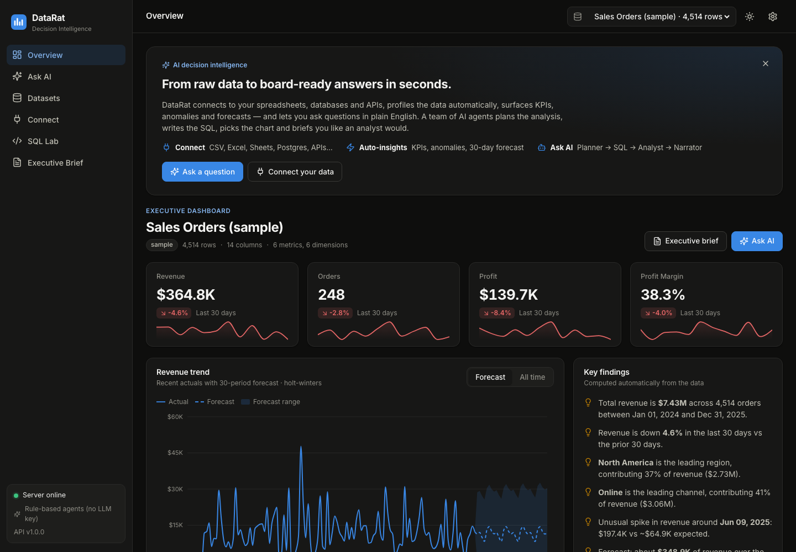

# 🐀 DataRat — AI Decision Intelligence for Business Leaders

**Connect any data source → instant KPIs, anomalies and forecasts → ask questions in plain English → a team of AI agents answers with SQL, charts and an executive narrative.**

**Live demo:** https://salimkt.github.io/DataRat/ &nbsp;·&nbsp; **API:** https://datarat-api.onrender.com/docs



> The API runs on Render's free tier, so the first request can take 30–50 s while the server wakes up. The UI shows a banner and retries automatically.

---

## What's interesting here
- **A four-agent pipeline with a self-correcting SQL step.** Planner → SQL Engineer → Analyst → Narrator. When a generated query fails, the database error is fed back to the SQL Engineer, which retries up to twice.
- **The LLM is optional, never trusted.** Gemini or Claude output is validated against a JSON schema; on any failure, or with no API key, a deterministic rules engine answers instead. The demo works with no key at all.
- **Defence in depth for user-supplied SQL and URLs.** A read-only guard allows a single `SELECT`/`WITH` statement with no file or I/O functions, DuckDB external file access is disabled and locked, uploads and remote fetches are size-capped, and connectors refuse private network addresses.
- **Real statistics, not just charts.** Holt-Winters forecasts with a confidence band, rolling z-score anomaly detection, and automatic profiling (quality score, semantic column typing, correlations).
- **122 backend tests** that run offline, with no API key and no network.

## Tech stack
- **Backend:** Python 3.11, FastAPI, DuckDB (in-memory), pandas, NumPy, statsmodels, SQLAlchemy; Gemini or Claude for the agents; deployed on Render
- **Frontend:** React 18, TypeScript, Vite, Recharts, React Router; deployed on GitHub Pages via GitHub Actions
- **Tests:** pytest

## Why
Business leaders don't want another BI tool to learn. They want answers like *"Which region is driving the profit drop and what should we do?"* DataRat turns raw tables into a briefing for executives in seconds, and every number links back to the SQL that produced it.

## Features
| | |
|---|---|
| 🔌 **11 connectors** | CSV/TSV, Excel, JSON, Parquet, SQLite, PostgreSQL, MySQL, Google Sheets, remote URL, REST API, sample datasets |
| 📊 **Executive dashboard** | Auto-detected KPIs with 30-day change and sparklines, trend chart with a **Holt-Winters forecast** and confidence band, top breakdowns, plain-English highlights |
| 🚨 **Anomaly detection** | Rolling z-score spikes and dips on the primary metric |
| 🧪 **Data profiling** | Quality score, missing/duplicate analysis, per-column stats and histograms, correlation heatmap, semantic column typing (metric, dimension, date, id) |
| 🤖 **Ask AI (multi-agent)** | Planner → SQL Engineer (self-correcting, up to 2 retries) → Analyst (stats and chart choice) → Narrator (executive summary, recommendations, follow-ups), shown as a live agent timeline |
| 🧑‍💻 **SQL Lab** | Run read-only DuckDB SQL across all connected datasets, with chart toggle |
| 📝 **Executive Brief** | One-click board-ready briefing you can print or export as Markdown |

## Architecture
```
┌────────────── GitHub Pages ──────────────┐        ┌──────────────── Render ────────────────┐
│ React 18 + Vite + TypeScript + Recharts  │  HTTPS │ FastAPI                                │
│ Overview · Connect · Datasets · Ask AI   │ ─────► │  ├─ Connectors (files, DBs, APIs)      │
│ SQL Lab · Executive Brief                │  JSON  │  ├─ DuckDB in-memory analytics engine  │
└──────────────────────────────────────────┘        │  ├─ Profiling · Insights · Forecasting │
                                                    │  └─ Agents: Planner → SQL → Analyst →  │
                                                    │           Narrator  (Claude or rules)  │
                                                    └────────────────────────────────────────┘
```
- **LLM optional, multi-provider.** With `GEMINI_API_KEY` set the agents use **Google Gemini** (`gemini-3.8-flash` by default, override with `GEMINI_MODEL`). With `ANTHROPIC_API_KEY` set they use Claude. Model output is JSON-validated against a schema, and any failure falls back to the rules. Without a key, a deterministic rule-based engine answers common business questions: totals, top-N, trends, averages, counts, comparisons, growth, shares, correlations, derived metrics (conversion rate, ROAS, CTR, margin, AOV) and relative date filters.
- **Safe by design.** Read-only SQL guard, DuckDB external file access disabled, upload and remote-fetch size limits, and blocking of private network addresses.

## Run locally
Requires Python 3.11 (the version Render uses) and Node 20+.

```bash
# backend: http://localhost:8000, API docs at /docs
cd backend
python3.11 -m venv .venv && source .venv/bin/activate
pip install -r requirements.txt pytest
pytest -q                                   # 122 tests, offline
uvicorn app.main:app --reload --port 8000

# frontend: in a second terminal, from the repo root
cd frontend && npm install
VITE_API_URL=http://localhost:8000 npm run dev
```

Set `GEMINI_API_KEY` or `ANTHROPIC_API_KEY` before starting the backend to turn on the LLM agents; without either, the rules engine answers. See [`backend/README.md`](backend/README.md) for all settings.

## Deploy
- **Frontend:** pushing to `main` runs `.github/workflows/deploy-pages.yml`, which deploys to GitHub Pages. Set the repo variable `VITE_API_URL` to point the UI at a different API.
- **Backend:** in Render, go to **New → Blueprint**, pick this repo, and it reads `render.yaml`. Add `GEMINI_API_KEY` (from https://aistudio.google.com/apikey) in the Render dashboard to turn on the Gemini-powered agents.

[](https://render.com/deploy?repo=https://github.com/salimkt/DataRat)

## Skills demonstrated
`SQL (DuckDB)` · `Python / pandas / NumPy` · `statsmodels time-series forecasting` · `anomaly detection` · `data quality profiling` · `KPI design` · `data visualization` · `ETL / data connectors` · `FastAPI` · `React + TypeScript` · `LLM multi-agent systems` · `CI/CD`

---
Built by **[Muhammed Salim K T](https://github.com/salimkt)**, AI/ML engineer focused on LLM systems, RAG, multi-agent orchestration and analytics.
