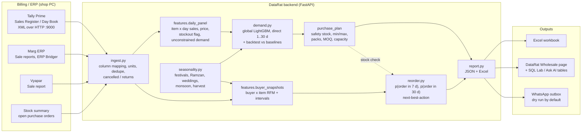
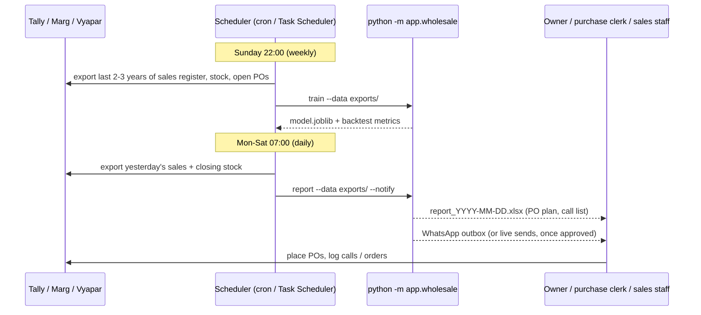

# Wholesale planner: demand forecasting, purchase orders and buyer reorder prediction

A blueprint and implementation guide for a B2B staples wholesaler (rice, sugar, pulses, cooking oil)
selling to kirana stores, hotels, caterers and bakeries. It is built into DataRat as
`backend/app/wholesale/`, the `/api/wholesale/*` routes and the **Wholesale** page.

Two questions it answers every morning:

1. **What should we buy today, and how much?** Item demand for the next 7, 15 and 30 days, turned
   into purchase-order quantities using stock on hand, stock on order, supplier lead times and
   safety stock.
2. **Who should we call or WhatsApp today?** Buyers likely to reorder an item within 7 days, and
   regular buyers who have gone quiet, ranked by expected order value.

Everything here runs on **synthetic data** (`app/wholesale/synthetic.py`). No real customer or
invoice data is in the repository. The numbers in section 3.3 come from that synthetic world, so
they show that the pipeline works and how the models compare. They are not a promise of accuracy on
a real business.

```bash
cd backend
python -m app.wholesale demo          # synthetic exports -> train -> Excel + JSON report + WhatsApp dry-run outbox
pytest -q tests/test_wholesale.py     # 25 tests, offline
```

---

## Contents
1. [Architecture](#1-architecture)
2. [Data architecture and feature engineering](#2-data-architecture-and-feature-engineering)
3. [Model selection and comparison](#3-model-selection-and-comparison)
4. [Inventory maths: safety stock, reorder point, order quantity](#4-inventory-maths)
5. [Edge cases](#5-edge-cases)
6. [Implementation guide](#6-implementation-guide)
7. [Deployment and shop-floor workflow](#7-deployment-and-shop-floor-workflow)
8. [Rollout roadmap](#8-rollout-roadmap)
9. [Limitations and next steps](#9-limitations-and-next-steps)
10. [Sources](#10-sources)

---

## 1. Architecture



**Cadence.** Training is weekly and inference is daily, so the daily job takes seconds and the
weekly job takes under a minute on a laptop.



**Code map** (`backend/app/wholesale/`)

| Module | Role |
|---|---|
| `config.py` | `PlannerConfig` (horizons, service level, review period, list size, thresholds) and WhatsApp settings |
| `seasonality.py` | Festival table, wedding, monsoon, harvest and sugar-season indices; calendar features |
| `synthetic.py` | Deterministic synthetic world: buyers, consumption, festivals, price shocks, warehouse stockouts, ERP-style exports |
| `ingest.py` | Tally / Marg / Vyapar / canonical exports and Tally XML to clean canonical tables, plus a data-quality report |
| `features.py` | Item x day panel with censored-demand correction; direct multi-horizon demand frame; buyer x item snapshots |
| `models.py` | LightGBM when it loads, else scikit-learn HistGradientBoosting |
| `demand.py` | Global demand model, backtest against 4 baselines, forecast-error sigmas, purchase plan |
| `reorder.py` | Reorder (7 d) and retention (30 d) classifiers, backtest, next-best-action list |
| `report.py` | Unified report dict and the formatted Excel workbook |
| `notify.py` | WhatsApp Cloud API template payloads; dry run by default |
| `pipeline.py` | `WholesalePlanner.fit / plan / save / load`, folder loader |
| `api.py` | `/api/wholesale/demo`, `/run`, `/report`, `/report.xlsx`, `/outbox` |
| `__main__.py` | CLI: `demo`, `generate`, `train`, `report` |

---

## 2. Data architecture and feature engineering

### 2.1 Getting data out of the ERP

| ERP | What to export | How |
|---|---|---|
| **Tally Prime** | Item-wise **Sales Register** or **Day Book** (sales, credit notes), **Stock Summary** (closing stock by item), **Purchase Order** outstanding, Stock Item master, Ledger master | Open the report and press **Ctrl+E** to export what is on screen. Formats are Excel, XML, JSON, PDF, HTML and ASCII. **Alt+E > Transactions** exports vouchers in bulk for a period [T1]. For automation, enable the **HTTP server (default port 9000)** and POST an XML export request. JSON requests are supported from Release 7.0 [T2]. ODBC (Excel DSN `TallyODBC64_9000`) is documented for **master data** (ledgers, stock items), not vouchers [T3]. |
| **Marg ERP** | Item / item-group wise sale report, sale bills, stock report | Daily Reports > Business Analysis > *Item Group wise Sale Report*, exported to Excel. **ERP Bridger** (Masters > MARG Setups > Advanced Features) exports many sale bills with chosen columns to one Excel file [M1]. No public API documentation was found, so plan on file exports [M2]. |
| **Vyapar** | Sale report, Day Book / All Transactions, item and party reports | Sale, Purchase, Day Book and All Transactions reports export to Excel (the xls icon) [V1]. *Item Report by Party* and *Party Report by Items* exist [V2], but Excel export for those was not confirmed. Use the Sale report with item detail. |

**Tally voucher XML.** A sales voucher carries `DATE` (YYYYMMDD), `VOUCHERTYPENAME`,
`VOUCHERNUMBER` and the party, plus one `ALLINVENTORYENTRIES.LIST` per item with `STOCKITEMNAME`,
`ACTUALQTY`, `BILLEDQTY` (e.g. `" 4 Bag"`), `RATE` (`"1300.00/Bag"`) and `AMOUNT`. Godown and batch
sit in `BATCHALLOCATIONS.LIST`. The party appears as `PARTYLEDGERNAME` in many exports. Tally's
published sample instead marks the party ledger entry with `ISPARTYLEDGER=Yes` [T2][T4].
`ingest.parse_tally_xml` accepts both forms and turns cancelled vouchers (`ISCANCELLED=Yes`) into
dropped rows.

**Cross-check against GST e-invoice fields.** INV-01 (IRP schema v1.03) line items carry `HsnCd`
(4/6/8 digits), `Qty`, `Unit` (a UQC code, mandatory for goods), `UnitPrice`, `TotAmt`, `GstRt`,
and the buyer's 15-character `BuyerDtls.Gstin` [G1]. If the trader issues e-invoices, those JSONs
are a clean alternative source with the same fields.

### 2.2 Canonical schema

Whatever the source, `ingest.load()` produces these tables. Required columns are in **bold**.

**`invoice_lines`**: one row per invoice x item.

| Column | Type | Tally | Marg | Vyapar | Notes |
|---|---|---|---|---|---|
| **date** | date | Date / `DATE` | Bill Date | Date | dd-mm-yyyy, dd-Mon-yyyy, ISO and YYYYMMDD are parsed day-first |
| invoice_no | text | Voucher No. | Bill No | Invoice No. | |
| voucher_type | text | Voucher Type | Type | Transaction Type | Sales kept; credit notes / sale returns become `is_return`; cancelled vouchers are dropped |
| **buyer_id** | text | Particulars / party ledger | Party | Party Name | normalised name (case, spaces, punctuation) |
| gstin | text | GSTIN/UIN | | | |
| **sku** / item_name | text | Stock Item | Product | Item Name | mapped through the item master |
| commodity | text | Stock group | | | rice / sugar / pulses / oil / other (guessed from the name if missing) |
| **qty** | float | Quantity / `BILLEDQTY` | Qty + Unit | Quantity + Unit | converted to the **base unit** (kg or L) using the pack size: "4 Bag" of a 25 kg bag = 100 kg |
| rate | float | Rate | Rate | Price/Unit | Rs per base unit, derived as amount / qty |
| amount | float | Value / `AMOUNT` | Amount | Amount | |

**`items`** (stock item master): `sku, item_name, commodity, base_unit, pack_unit, pack_size,
lead_time_days, lead_time_sd, moq_packs, supplier, capacity_packs, [purchase_cost_ratio]`. Pack size
and base unit are guessed from names like "Matta Rice 25kg" when missing. Lead time defaults to
7 ± 2 days. **Get real lead times from the supplier ledger (PO date to receipt date).**

**`parties`** (ledger master): `party, segment (kirana | hotel | caterer | bakery), area, gstin,
phone, whatsapp_opt_in`. Segment can come from the Tally ledger group ("Sundry Debtors - Hotels").

**`stock`**: `date, item, closing_qty`, a daily closing-stock snapshot. It is optional, but without
it the PO plan only shows min/max levels (`CHECK STOCK`) and stockouts have to be inferred.

**`open_pos`**: `item, qty, expected_date` for purchase orders placed but not received.

### 2.3 Cleaning rules (counted in `data_quality`)

| Rule | Why |
|---|---|
| Drop exact duplicate rows | Re-exports and copy-paste merges duplicate lines |
| Drop cancelled vouchers | Cancelled in Tally, but still listed in the Day Book |
| Keep credit notes / sale returns as `is_return`, excluded from demand | A damaged bag returned is not negative demand |
| Drop non-sales vouchers (receipts, journals, purchases) | Day Book exports mix voucher types |
| Parse quantity strings, convert units via pack size | Bags, tins, kg, quintals and litres are mixed in one register |
| Normalise party names | "KIRANA 017  " and "Kirana 017" are the same shop |
| Unknown items: keep, slug the SKU, guess the commodity, list them | New items show up before the master is updated |

### 2.4 Demand features (`features.demand_frame`)

The demand model is **global** (one model for all items) and **direct multi-horizon**. For forecast
origin *t* (the last day with data) and horizon *k* = 1..30, the target is
`demand(t+k) / scale(t)`, where `scale(t)` is the item's 56-day mean demand. Dividing by scale lets
fast and slow items share one model and helps new items.

| Group | Features (computed with data up to *t* only) |
|---|---|
| Level and trend | `r7, r14, r28, r91` = rolling mean / scale; `trend = r7 - r28`; `last` = demand(t) / scale |
| Volatility and intermittency | `sd28` (CV of the last 28 days), `zero28` (share of zero days), `since_nz` (days since the last non-zero day) |
| Weekly pattern | `dow_mean` = mean of the last 8 same-weekday values for the *target* weekday / scale |
| Yearly pattern | `ly` = centred 7-day mean exactly 364 days before the target day / scale (NaN in year one) |
| Price | `price_rel90` = price / 90-day mean; `price_ch14`, `price_ch30` = % change |
| Censoring | `so28` = stockout days in the last 28 days |
| Item | `sku`, `commodity` (categorical), `age` (days of history) |
| Horizon | `k` |
| Calendar of the **target** day | weekday, day of month, month, ISO week, `month_start_week` (post-salary restocking), festival weight, `festival_pull` (decaying 0..21 days before a festival), days to the next major festival, days since the last festival, `ramzan`, `wedding_index`, `sw_monsoon`, `kharif_harvest`, `rabi_harvest`, `sugar_crushing` |

### 2.5 Buyer x item RFM features (`features.buyer_snapshots`)

One row per (buyer, item, cutoff date). Labels: `y_7` = orders the item within (cutoff, cutoff+7]
and `y_30` within 30 days.

| Feature | Definition |
|---|---|
| `recency` | days since the last order of this item |
| `n_orders`, `n_30`, `n_90` | orders ever / in the last 30 / 90 days (frequency) |
| `qty_90`, `amount_90` | kg (or L) and Rs in the last 90 days (monetary / quantity) |
| `mean_int`, `std_int`, `last5_int`, `cv_int` | mean, std, last-5 mean and CV of days between orders |
| `mean_int_shrunk` | **empirical-Bayes interval**: (n_int · mean_int + k · prior) / (n_int + k), with k = 3 and the prior = median interval of the buyer's segment x commodity. A buyer with one order gets the segment norm, and a buyer with 30 orders gets their own rhythm. |
| `due_ratio` | recency / mean_int_shrunk (1.0 = due today) |
| `z_due` | (recency - mean_int_shrunk) / (shrunk std + 1) |
| `gap_left` | mean_int_shrunk - recency (days until due) |
| `last_qty_ratio` | last order qty / median of the last 5 (a big last order means a longer gap; this captures **hoarding**) |
| `tenure`, `recency_any`, `items_90` | days since the first order; days since *any* order by this buyer; breadth of their basket |
| `price_ch14`, `price_rel90`, `item_so7` | price momentum and our own stockouts of the item (buyers may have bought elsewhere) |
| `w_pull`, `w_wedding`, `w_ramzan` | festival pull, wedding index and Ramzan over the next 7 days |
| `segment`, `commodity` | categorical |

### 2.6 External seasonal regressors (`seasonality.py`)

| Regressor | What we encode | Basis |
|---|---|---|
| Festivals | Per-year dates for Sankranti/Pongal, Holi, Vishu, Eid al-Fitr, Eid al-Adha, Onam, Ganesh Chaturthi, Dussehra, Diwali and Christmas, each with a weight and the commodities it lifts. Region filter (`kerala` adds Vishu and Onam). | Lunar dates move every year. **The dates in the table are approximate and cover 2023-2027.** Replace them with the state government holiday list before going live. |
| Ramzan | 29 days before Eid al-Fitr (iftar demand from hotels: rice, sugar, oil) | Derived from the Eid date |
| Wedding season | Monthly index peaking Nov-Feb and Apr-May; the Kerala profile adds Chingam (Aug-Sep) and dips in Karkidakam (Jul-Aug) | An **assumption** (a prior the model can down-weight). One data point on the scale: CAIT estimated 48 lakh weddings between 12 Nov and 16 Dec 2024 [S8]. |
| Southwest monsoon | Flag for June-September | IMD: onset over Kerala is normally 1 June (std. dev. about 7 days); the season is June-September [S5][S6] |
| Harvest | Kharif harvest (rice) Oct-Dec; rabi harvest (wheat, chana) Mar-Apr | Kharif is sown in the monsoon and harvested around Oct-Nov; rabi is sown in winter and harvested in spring. Timing varies by region [S7] |
| Sugar season | Crushing flag Nov-Apr | The sugar marketing season runs October-September; crushing windows vary by state [S9] |
| Price shocks | Not a calendar input; captured by the price features | Examples of real shocks: non-basmati white rice exports prohibited on 20 July 2023 [S10]; stock limits on tur and chana of 200 MT for wholesalers from June 2024 to 30 Sep 2024 [S11]; edible-oil basic customs duty raised on 14 Sep 2024 (crude oils 0% to 20%) [S12] |

---

## 3. Model selection and comparison

### 3.1 What the evidence says

* **M5 competition (Walmart, 42,840 series, 5,507 teams, metric WRMSSE).** The winner improved on the
  best benchmark (bottom-up exponential smoothing) by 22.4%, and all top-50 teams by more than 14%.
  The paper notes that most methods used **LightGBM**, including 4 of the top 5. The 3rd place was an
  LSTM ensemble [M5]. The winner trained on a **Tweedie** loss, and other top entries used Tweedie or
  Poisson [M5]. LightGBM's `tweedie` objective uses a log link with variance power in [1, 2) [L1].
* **The gain shrinks at the bottom of the hierarchy.** In M5 the improvement over exponential
  smoothing was about 40% at the total level but only about 3% at the product-store level, and some
  top-50 teams lost to the benchmark there [M5]. So simple methods stay competitive on very
  granular, noisy series, which is why every forecast here is scored against baselines.
* **Temporal Fusion Transformer** gives interpretable multi-horizon forecasts with static,
  known-future and observed inputs [TFT]. It needs far more series, GPU time and tuning than an SME
  has.
* **Intermittent demand:** Croston (1972) splits demand into size and interval [C1]. The
  Syntetos-Boylan approximation removes Croston's bias [C2]. The ADI / CV² classification (ADI 1.32,
  CV² 0.49) separates smooth, intermittent, erratic and lumpy series [C3][C4].
* **Censored demand:** with stockouts, sales understate demand. Estimates improve when you know
  *when* the stockout happened [CD1], and Tobit-style models treat the censored days explicitly [CD2].

### 3.2 Comparison

**(a) Multi-item demand forecasting (daily, 1-30 days ahead, 10-200 items)**

| | MLP / LSTM / TFT | Gradient-boosted trees (LightGBM, XGBoost) | Prophet / SARIMAX / ETS (Holt-Winters) | Croston / SBA |
|---|---|---|---|---|
| Accuracy at SME scale | Good with lots of series; overfits with 10-50 items and 2-3 years | **Best in M5**; strong with calendar and price features | Fine for smooth single series; misses item interactions | Only for intermittent series |
| Uses festivals / price / stockouts | Yes (TFT: known-future inputs) | Yes, any tabular feature | Prophet: holidays and regressors; SARIMAX: exogenous regressors | No |
| Shares strength across items | Yes | Yes (global model) | No (one model per series) | No |
| Cold-start items | Possible with embeddings | Yes, via scale normalisation and commodity features | No | No |
| Training cost | GPU or minutes-hours on CPU | **Seconds** on CPU | Seconds per series; slow at hundreds of series | Trivial |
| Ops burden | High (framework versions, tuning) | Low (one pip package) | Low-medium | Very low |
| Interpretability | Low (TFT: attention) | Feature importance / SHAP | High | High |

**(b) Buyer reorder (binary: orders item X in the next 7 days?)**

| | Rules (due ratio) | Logistic regression | Gradient-boosted classifier | Neural (sequence) models |
|---|---|---|---|---|
| Accuracy | Baseline | Better; misses non-linear effects (hoarding, festivals) | **Best on tabular RFM features** | Similar to GBM on tabular data; needs much more data |
| Calibration | None | Good | Good (check Brier) | Varies |
| Cost / ops | None | Trivial | Seconds | High |
| Explainability for sales staff | Very high | High | Medium; the list shows the interval / recency reason | Low |

### 3.3 Results on the synthetic data

Run: `python -m app.wholesale demo` (seed 7, 120 buyers, 13 items, 2024-01-01 to 2026-10-31,
30,340 billed lines, 11% of requested quantity lost to stockouts). LightGBM backend.

**Demand backtest**: hold-out of the last 84 days, 8 weekly forecast origins, 11 items with enough
history. Errors are measured on in-stock days only. WAPE = Σ|forecast - actual| / Σ actual over
item x origin windows. MASE = MAE / in-sample MAE of the weekly seasonal naive forecast.

| Model | WAPE 7 d | WAPE 15 d | WAPE 30 d | Bias 30 d | MASE (daily) |
|---|---|---|---|---|---|
| **LightGBM (global, direct)** | **0.283** | **0.186** | **0.122** | +5.2% | **0.70** |
| Naive (28-day mean) | 0.548 | 0.525 | 0.400 | +14.7% | 1.02 |
| Seasonal naive (8-week weekday profile) | 0.518 | 0.440 | 0.266 | +13.8% | 0.89 |
| Holt-Winters (additive, damped, weekly) | 0.439 | 0.455 | 0.462 | +7.0% | 0.99 |
| Croston-SBA | 0.461 | 0.427 | 0.363 | +7.2% | 0.99 |

The hold-out includes Onam and the run-up to Diwali. Calendar features (`festival_pull`,
`days_since_festival`, `days_to_major_festival`) and the year-ago feature (`ly`) are among the top
LightGBM features, which is why it beats the univariate baselines most clearly on festival weeks.

**Censored demand correction**: on stockout days billed sales captured 23% of true demand and the
corrected series 79%. Over the whole history it was 89% vs 98% (latent demand is known in the
synthetic world). Without a stock file, the inferred-stockout rule still lifts the total to 96%.

**Buyer reorder backtest**: 77 daily lists (9 Aug to 24 Oct 2026), 53,486 buyer x item rows, base
rate 28.4%, list size 40.

| Model | ROC-AUC | PR-AUC | Brier | Precision@40 | Recall@40 |
|---|---|---|---|---|---|
| **LightGBM classifier** | **0.824** | **0.621** | 0.151 | **0.689** | **0.139** |
| Rule: due ratio (lapsed > 2x excluded) | 0.679 | 0.384 | n/a | 0.368 | 0.078 |

* **Churn / win-back** head (no order in 30 days, regular buyers with 4+ orders): ROC-AUC 0.842,
  PR-AUC 0.735 vs 0.518 for the overdue-ratio rule (base rate 23.3%).
* **Cold-start pairs** (fewer than 3 orders): PR-AUC 0.610 vs 0.617 for the rule. With no history the
  model has nothing to add beyond the segment prior that both use. This is expected and is why
  intervals are shrunk towards segment norms.

With the scikit-learn fallback (no LightGBM), demand WAPE-30 is 0.141 and reorder PR-AUC 0.621,
which is close enough that the fallback is a safe default.

### 3.4 Recommended production stack

| Layer | Choice | Why |
|---|---|---|
| Demand | **One global LightGBM model, Tweedie loss, direct multi-horizon (k = 1..30)**, scale-normalised target | M5 evidence, seconds to train, handles festivals, price and new items; the direct daily path gives any window sum (lead time, 7/15/30 days) |
| Benchmarks kept in production | Seasonal naive, Holt-Winters, Croston-SBA | Re-scored at every retrain; if one beats the model for an item, flag it |
| Reorder / churn | LightGBM classifiers on RFM + interval features (7-day and 30-day heads) | Best PR-AUC and precision@k; explainable through the interval / recency reason |
| Uncertainty | Backtest error distribution per item and window (`sigma_e(P)`) | Feeds safety stock directly; no distributional assumption about demand |
| Fallback | scikit-learn HistGradientBoosting | Same model family; no OpenMP dependency on macOS |
| Not recommended now | TFT / LSTM, per-item Prophet | Cost and maintenance are out of proportion for 10-200 items |

---

## 4. Inventory maths

Notation: *L* = supplier lead time (days), σ_L = its standard deviation, *R* = review period (how
often an item is reordered, default 7 days), *z* = inverse normal of the cycle service level
(95% gives z = 1.645), D(P) = forecast demand over the next *P* days.

**Classic safety stock**, assuming independent, normally distributed daily demand with mean d̄ and
standard deviation σ_d [S1]:

$$SS = z\sqrt{L\,\sigma_d^2 + \bar d^{\,2}\,\sigma_L^2}$$

**What the code uses** (`demand.purchase_plan`) replaces the demand-variance term with the measured
forecast error over the window. You protect against the error of the forecast, not the raw
variability of demand:

$$SS(P) = z\sqrt{\sigma_e(P)^2 + \bar d^{\,2}\,\sigma_L^2}, \qquad \bar d = D(L)/L$$

where σ_e(P) is the RMSE of the *P*-day forecast sum in the backtest. The pooled relative error,
times 1.5, is used for items without a backtest.

| Quantity | Formula | Tally name |
|---|---|---|
| Reorder point (min) | ROP = D(L) + SS(L) | Reorder Level |
| Order-up-to (max) | S = D(L+R) + SS(L+R) | (max level) |
| Inventory position | IP = on hand + on order | |
| Order quantity | if IP ≤ ROP: ⌈(S - IP) / pack⌉ packs, at least the MOQ, capped at capacity - IP | Minimum Order Qty |
| Projected stockout day | first *k* where on hand + arrivals(≤ k) - Σ forecast(1..k) < 0 | |

**Status.** `URGENT` means order now and stock runs out within the lead time. `EXPEDITE` means
enough is on order but it lands after the projected stockout, so chase the supplier. `ORDER` means
below the reorder point. `CHECK STOCK` means there is no stock snapshot, so only min/max levels are
shown. `OK` means above the reorder point, with the next order date shown.

**Worked example** (the case checked in `test_purchase_plan_formulas`): Matta rice, 100 kg/day,
L = 4 ± 1 days, R = 7, σ_e(P) = 10√P kg, 25 kg bags, MOQ 40 bags, 300 kg on hand.

* SS(4) = 1.645 · √(20² + 100² · 1²) = 1.645 · 102.0 = 167.8 kg
* ROP = 400 + 167.8 = 567.8 kg. IP = 300 is below it, so order.
* S = 1,100 + 1.645 · √(33.2² + 100²) = 1,100 + 173.3 = 1,273.3 kg
* Order = ⌈(1,273.3 - 300) / 25⌉ = 39 bags, raised to the MOQ = **40 bags (1,000 kg)**
* Stock covers 3 days and runs out on day 4 = L, so the status is **URGENT**.

---

## 5. Edge cases

| Edge case | What goes wrong | How the code handles it | Where |
|---|---|---|---|
| **Sparse history** (new trader, < 1 year) | No year-ago signal; few training rows | Global model shares strength across items; `ly` is NaN-tolerant; scale normalisation | `features.demand_frame` |
| **Intermittent buyer orders** | Buyer x item series are mostly zeros | Model buyers with **interval features**, not daily series; Croston-SBA is kept as an item baseline; Tweedie / Poisson loss for zero-heavy targets | `features.buyer_snapshots`, `demand.croston_sba` |
| **Caterers (lumpy, event-driven)** | Huge, irregular orders | Wedding index and festival pull as features; channel is a call, not WhatsApp | `seasonality`, `reorder.call_list` |
| **Bulk festive hoarding** | Big order before Onam / Diwali, then a long gap; lag features spike | `festival_pull` and days-to/since-festival features; `last_qty_ratio` (a big last order predicts a longer gap) | `seasonality.calendar_features`, `features` |
| **Commodity price swings** (export bans, duty changes, stock limits) | Forward-buying before rises, waiting when prices fall | Price momentum features (`price_ch14/30`, `price_rel90`) in both models; only past prices are used, so there is no leakage | `features` |
| **Stockouts in history (censored demand)** | Sales < demand, so the model learns to under-forecast and under-order, and stockouts repeat | Flag stockout days from closing stock (or infer them from zero runs on busy items); replace censored days with max(sales, in-stock baseline x weekday factor); weight imputed targets 0.5; evaluate only on in-stock days | `features.unconstrain`, `suspect_stockouts`, `demand._score` |
| **Cold-start item** | No history | < 14 days: blend its own mean with 25% of the commodity's average item and the commodity's weekday profile (`method = cold_start`); 1.5x the pooled error for safety stock | `demand._cold_start`, `sigma_for` |
| **Cold-start buyer** | 1-2 orders; interval unknown | Empirical-Bayes shrinkage of the interval towards the segment x commodity median | `features.interval_priors` |
| **Churn** | Regular buyer silently moves to a competitor | 30-day retention head; a win-back call when churn risk ≥ 0.6 and recency > 1.5x the interval | `reorder.call_list` |
| **Supplier delays** | Open PO arrives after the shelf is empty | `EXPEDITE` status from projected stock with expected arrival dates | `demand.purchase_plan` |
| **Returns, cancelled and duplicate vouchers** | Inflated or negative demand | Dropped or flagged with counts in `data_quality` | `ingest.clean_invoices` |
| **Mixed units** ("4 Bag", "100 kg", quintal, litres) | Wrong quantities by 25-50x | Unit parser plus pack size from the master, or from the item name | `ingest.split_qty`, `guess_pack` |
| **No stock export** | Order quantities would assume zero stock | `CHECK STOCK`: show min/max only, never order blindly | `demand.purchase_plan` |
| **Day-first dates** | 03/04 read as 4 March | Day-first parsing for Indian formats | `ingest.parse_dates` |
| **Festival calendar drift** | Lunar festivals move 10-20 days a year | Per-year date table; replace it with the official list each year | `seasonality.FESTIVALS` |

---

## 6. Implementation guide

The code is commented module by module. Read in this order: `ingest.py` → `features.py` →
`demand.py` → `reorder.py` → `report.py` → `pipeline.py`.

**(a) Cleaning and features from raw exports**

```python
from app.wholesale import ingest, features
data = ingest.load(invoices_df, items_df, parties_df, stock_df, open_pos_df, erp="auto")
print(data.quality)                  # rows in/out, duplicates, cancelled, returns, unknown items
panel = features.daily_panel(data)   # item x day: sales, price, stockout, unconstrained demand
```

**(b) Training and evaluation of both models**

```python
from app.wholesale.config import PlannerConfig
from app.wholesale.pipeline import WholesalePlanner
planner = WholesalePlanner(PlannerConfig(service_level=0.95, review_days=7, call_list_size=40))
metrics = planner.fit(data)   # demand backtest vs 4 baselines, reorder + churn backtest, then refit on all data
planner.save("var/wholesale/model.joblib")
```

**(c) Unified daily report**

```python
report = WholesalePlanner.load("var/wholesale/model.joblib").plan(data)
from app.wholesale.report import write_excel
write_excel(report, "var/wholesale/report.xlsx")   # Summary, PO Plan, Call List, Forecast, Daily Forecast, Model Metrics, Data Quality
from app.wholesale import notify
notify.deliver(report, "var/wholesale")            # dry run: writes outbox_<date>.json
```

**CLI** (from `backend/`)

```bash
python -m app.wholesale generate --out var/wholesale/data --erp tally   # or vyapar / marg / canonical
python -m app.wholesale train  --data var/wholesale/data                 # weekly
python -m app.wholesale report --data var/wholesale/data --notify        # daily
```

**API and UI.** `POST /api/wholesale/demo` and `POST /api/wholesale/run` train and plan.
`GET /api/wholesale/report`, `/report.xlsx` and `/outbox` read the latest result (contract in
`SPEC.md`). The clean invoice lines, PO plan, call list and forecast are registered as DuckDB
tables, so **SQL Lab** and **Ask AI** work on them. For example: *"total qty by commodity"* on
`wholesale_invoices`.

**Tests** (`tests/test_wholesale.py`, 25 tests): determinism of the synthetic data; all four ERP
formats reconcile to the ground truth; quantity and date parsing; Tally XML (both party
conventions, cancelled vouchers); calendar features; censoring correction against the latent truth;
inferred stockouts; label leakage; Croston-SBA; the backtest beats naive; the purchase-plan formulas
by hand; reorder PR-AUC beats the rule; call-list ranking, channels and opt-in; Excel sheets; the
WhatsApp stub never sends; save/load; a short upload whose dates are all ambiguous stays day-first; and the API end to end, including an uploaded Vyapar CSV.

---

## 7. Deployment and shop-floor workflow

**Option A: one PC at the shop (lowest cost, recommended to start).** Tally runs on a Windows PC
anyway. Install Python on it.
* **Weekly** (Sunday night): Task Scheduler runs a script that pulls vouchers from Tally's HTTP
  port (or a saved Ctrl+E export) and calls `train`.
* **Daily** (07:00, Mon-Sat): export yesterday's sales and closing stock, then call
  `report --notify`. The workbook lands in a shared folder or is emailed to the owner. The
  purchase clerk reads the **PO Plan** sheet, and sales staff work the **Call List** sheet.
* Nothing leaves the shop except WhatsApp messages, once those are switched on.

**Option B: DataRat hosted** (Render or any small VM). Upload the exports on **Connect**, then on
**Wholesale** click *Use my data*. Good for a multi-branch owner who wants the dashboard on a phone.
The free Render tier sleeps and has little CPU. Use a paid instance or a cron job for daily runs,
and keep training on the fast config.

**Why not Streamlit?** DataRat already has a React dashboard, so the planner is a page there and the
same tables are available in SQL Lab and Ask AI. If you want a standalone Streamlit app,
`report.build_report` returns plain JSON that it can render directly.

**WhatsApp Business.** `notify.py` builds Cloud API **template** messages for buyers who opted in
and whose channel is WhatsApp (kiranas and bakeries below the call threshold). Defaults:
`DATARAT_WHATSAPP_MODE=dry_run` writes `outbox_<date>.json` and sends nothing. Before going live:
1. Get a WhatsApp Business account and phone number, and get a **template approved by Meta**.
   Business-initiated messages must use templates.
2. Record each buyer's **opt-in** in the party master (`whatsapp_opt_in`).
3. Budget for it. Since 1 July 2025 Meta charges **per delivered template message**, by category
   (marketing, utility, authentication). The pricing page also notes that utility messages inside
   the customer-service window are charged again from 1 Oct 2026 [W1]. Check current rates before
   enabling `live`.
4. Start with 10-20 messages a day and compare reply and order rates with phone calls.

**Monitoring.** These come out of every retrain: WAPE / bias by item vs the baselines, reorder
PR-AUC and precision@k, stockout days share, and the list's hit rate. Feed call outcomes (ordered /
not / wrong number) back as data. Alert if the model loses to seasonal naive for 2 weeks in a row
or the stockout share rises.

---

## 8. Rollout roadmap

| Phase | Weeks | Work | Exit criterion |
|---|---|---|---|
| 0. Data audit | 1 | Export 2-3 years of sales register, stock summary, item and party masters. Run `ingest.load` and fix item names, pack sizes and units. Collect real supplier lead times. Tag party segments and WhatsApp opt-ins. | `data_quality` shows < 1% unknown items and no unit surprises |
| 1. Shadow mode | 2-3 | Run `train` weekly and `report` daily, but keep ordering as usual. Compare the PO plan with actual POs, and the call list with who actually ordered. | Backtest WAPE-30 beats seasonal naive on most volume; precision@40 is meaningfully above the base rate |
| 2. Purchase assist | 4-6 | The purchase clerk uses the PO Plan as the starting point and logs overrides. Tune service level per item (A items 97-98%, slow items 90%). | Fewer stockout days, stock days not higher; overrides < 30% of lines |
| 3. Outreach pilot | 6-8 | Sales staff call the top 20-40 daily and record outcomes. | Orders from the list vs a control group of similar buyers not called |
| 4. WhatsApp | 8-10 | Template approved, opt-ins recorded. Switch kiranas to `live` with a daily cap. | Reply / order rate; cost per order below the call cost |
| 5. Refinement | ongoing | Add credit limits and outstanding dues (do not push stock to buyers over their limit), supplier price lists for buy-ahead decisions, and multi-godown stock. | |

---

## 9. Limitations and next steps

* **Synthetic results.** The backtest numbers come from a simulated world whose behaviour matches the
  model's assumptions (festival pull, interval-driven reorders). Expect lower accuracy on real data,
  and judge the model in phase 1 against the baselines it ships with.
* **Festival dates** are approximate and only cover 2023-2027.
* **Lead times** are a mean and std per item. Real supplier performance should be measured from PO
  and GRN dates.
* **No credit-risk feature yet.** The call list does not know outstanding dues. Tally's Bills
  Receivable would add it.
* **Cash and space constraints** are applied per item (capacity cap), not jointly across items.
* **Prices** are taken as given. A buy-ahead recommendation when supplier prices are about to rise
  needs supplier price history.
* **Ambiguous dates.** In uploads, `nn/nn/yyyy` columns are read day-first when any day is above 12,
  month-first when any month slot is above 12, and otherwise by `DATARAT_DATE_ORDER` (default `dmy`).
  A US user uploading a short, fully ambiguous file should set `DATARAT_DATE_ORDER=mdy`.

---

## 10. Sources

**Tally Prime**
- [T1] TallyHelp, "How to Export Data in TallyPrime": https://help.tallysolutions.com/tally-prime/data-management/export-data-in-tally/
- [T2] TallyHelp, "XML Integration": https://help.tallysolutions.com/xml-integration/
- [T3] TallyHelp, "Extract Data into MS Excel Using ODBC in TallyPrime": https://help.tallysolutions.com/tally-prime/data-management/extracting-master-data-to-microsoft-excel-using-odbc-tally
- [T4] TallyHelp, "Sample XML": https://help.tallysolutions.com/sample-xml/

**Marg ERP / Vyapar**
- [M1] Marg care, Item Group wise Sale Report: https://care.margcompusoft.com/margerp/transaction-analysis/172665/1/adler32 ; ERP Bridger export: https://care.margcompusoft.com/margerp/erp-bridger/177823/1/How-to-Export-Multiple-Sale
- [M2] Apideck, Marg ERP listing (not supported): https://www.apideck.com/accounting-software/marg-erp ; Marg Books e-commerce via Vinculum: https://care.margcompusoft.com/marg-book/e-commerce/184130/9/what-is-the-process-of-e---commerce-vinculum-in-marg-books
- [V1] Vyapar, transaction reports: https://vyaparapp.in/guides/how-to-check-transaction-reports-in-vyapar-app
- [V2] Vyapar, feature list: https://vyaparapp.in/blog/vyapar-app-complete-feature-list-all-about-your-favorite-billing-software/

**GST e-invoice**
- [G1] NIC e-invoice API sandbox, Generate IRN (schema v1.03): https://einv-apisandbox.nic.in/version1.03/generate-irn.html ; UQC master codes: https://einvoice1.gst.gov.in/Others/MasterCodes

**Forecasting and inventory**
- [M5] Makridakis, Spiliotis & Assimakopoulos (2022), "M5 accuracy competition: Results, findings, and conclusions", IJF 38(4). https://doi.org/10.1016/j.ijforecast.2021.11.013 (preprint: https://statmodeling.stat.columbia.edu/wp-content/uploads/2021/10/M5_accuracy_competition.pdf)
- [TFT] Lim, Arık, Loeff & Pfister (2021), "Temporal Fusion Transformers for interpretable multi-horizon time series forecasting", IJF 37(4). https://doi.org/10.1016/j.ijforecast.2021.03.012
- [L1] LightGBM parameters (`objective=tweedie`, `tweedie_variance_power`): https://lightgbm.readthedocs.io/en/latest/Parameters.html
- [C1] Croston (1972), "Forecasting and stock control for intermittent demands", Operational Research Quarterly 23(3). https://econbiz.de/Record/forecasting-and-stock-control-for-intermittent-demands-croston/10002044036
- [C2] Syntetos & Boylan (2005), "The accuracy of intermittent demand estimates", IJF 21(2). https://ideas.repec.org/a/eee/intfor/v21y2005i2p303-314.html
- [C3] Syntetos, Boylan & Croston (2005), "On the categorization of demand patterns", JORS 56(5). https://ideas.repec.org/a/pal/jorsoc/v56y2005i5d10.1057_palgrave.jors.2601841.html
- [C4] frePPLe, demand classification (ADI 1.32 / CV² 0.49 cut-offs): https://frepple.com/?p=10503
- [CD1] Jain, Rudi & Wang (2015), "Demand Estimation and Ordering Under Censoring: Stock-Out Timing Is (Almost) All You Need", Operations Research 63(1). https://econpapers.repec.org/RePEc:inm:oropre:v:63:y:2015:i:1:p:134-150
- [CD2] Pedregal, Trapero & Holgado (2024), "Tobit Exponential Smoothing, towards an enhanced demand planning in the presence of censored data". https://arxiv.org/abs/2407.17920
- [S1] Wikipedia, "Safety stock": https://en.wikipedia.org/wiki/Safety_stock

**India seasonality and market events**
- [S5] IMD press release on monsoon onset over Kerala, 15 May 2026: https://mausam.imd.gov.in/Forecast/marquee_data/PRESS%20RELEASE_MOK%202026_15May.pdf
- [S6] IMD, Long Range Forecast for the 2026 Southwest Monsoon Season Rainfall (June-September): https://mausam.imd.gov.in/Forecast/mcmarq/mcmarq_data/Long%20Range%20Forecast%20for%20the%202026%20Southwest%20Monsoon%20Season%20Rainfall%20(June-September).pdf
- [S7] Arthapedia (Indian Economic Service), cropping seasons: https://ies.gov.in/arthapedia/concept/cropping-seasons-india-kharif-rabi ; Wikipedia, "Kharif crop": https://en.wikipedia.org/wiki/Kharif_crop
- [S8] The Tribune, CAIT wedding-season estimate (Nov-Dec 2024): https://www.tribuneindia.com/news/business/wedding-season-business-expected-to-surge-41-per-cent-to-rs-6-lakh-crore-confederation-of-all-india-traders
- [S9] The Tribune, ISMA on sugar availability (season Oct-Sep): https://www.tribuneindia.com/news/business/industry-body-isma-sees-sufficient-sugar-availability-to-meet-indias-demand
- [S10] LiveLaw, DGFT Notification 20/2023 (non-basmati white rice exports prohibited): https://www.livelaw.in/tax-cases/dgft-amends-export-policy-of-non-basmati-white-rice-from-free-to-prohibited-233360
- [S11] News on AIR, stock limits on tur and chana (June 2024): https://www.newsonair.gov.in/centre-imposes-stock-limits-on-tur-chana-and-kabuli-chana-to-improve-affordability-of-pulses-for-consumers
- [S12] PIB press release on edible-oil customs duty (Sept 2024): https://pib.gov.in/PressReleasePage.aspx?PRID=2055643

**WhatsApp**
- [W1] Meta for Developers, WhatsApp Business Platform pricing: https://developers.facebook.com/documentation/business-messaging/whatsapp/pricing
